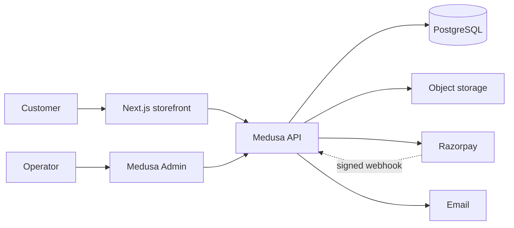

# Architecture (working assumption — pending KUR-002)

Visual: [html/architecture.html](html/architecture.html)

This is **not** a frozen ADR. KUR-002 must still beat Option A against Option B with current Medusa version, Razorpay plugin status, hosting ToS, and INR costs.

## Option A — preferred

```
Customer browser
    → Next.js storefront (SSR/SSG + cart UI)
        → Medusa JS API (catalogue, cart, checkout, customers, orders)
            → PostgreSQL
            → Object storage (images)
            → Razorpay (orders + webhooks, never card data)
            → Email provider (after approval; log-to-console until then)
        → Medusa Admin (founders / operations)
```

One commerce backend. Storefront and Admin are separate UIs on the same engine. Not microservices.

### Why A

- Catalogue, variants, inventory, carts, orders, refunds already exist
- Admin exists; we do not build a custom dashboard in MVP
- We still own code, DB, and the customer list
- Can replace the storefront without throwing away orders
- Matches “custom website” without reinventing checkout math

### Why A can fail

- Medusa v2 + Razorpay plugin/version mismatch (highest technical risk)
- Node on this host is v26 (Hermes-bundled), not Medusa’s usual 20/22 LTS
- No Docker / Postgres / C compiler on the agent box today (KUR-005 must install or we host elsewhere)
- 2 vCPU / 8 GiB Hostinger VPS is shared with Hermes — not assumed as production

## Option B — fallback

Next.js storefront + a small Node/Python order service + Postgres + Razorpay Checkout.

Wins only if A is incompatible or too heavy for one operator. Loses Medusa Admin; we would then need a tiny internal order screen (still not a full BI dashboard).

## Trust boundaries

| Flow | Rule |
|------|------|
| Browser says “paid” | Ignored. Order becomes paid only after Razorpay signature / webhook verify |
| Webhooks | Signed, idempotent, rate-limited |
| Cards / CVV | Never stored. Never logged |
| Secrets | Env / vault only. Not git, not kanban, not chat |
| Admin | Role-based. Non-devs use Admin, not SSH |
| Inventory | Stock at variant (size × colour). Concurrent checkout cannot oversell |

## Product model (kurta set, not a T-shirt)

A sellable SKU is a **kurta set variant**:

- Product: named set (fabric story, care, fit notes, size chart)
- Variant: size × colour (optional fit)
- Attributes: fabric, care, fit guidance
- Inventory: per variant
- Images: gallery per product, optional per colour

This is locked in KUR-007. Wrong model here is expensive later.

## Environments

| Env | Purpose |
|-----|---------|
| Local | Medusa + Postgres + storefront for KUR-005+ |
| Staging | Full purchase in Razorpay **test** mode |
| Production | Live keys only after KUR-026 + your approval |

This Hermes VPS is **not** automatically production.

## Hosting (undecided)

KUR-002 must pick with ToS + cost:

- Small commercial VPS (app + Postgres) — likely cheapest honest option
- Managed Postgres + small app host
- **Not** a free hobby PaaS if their ToS forbids commercial checkout

CDN / image host: cheapest commercial-ok object storage. No paid CDN signup without approval.

## What the diagram is allowed to claim

- India-first HTTPS storefront
- Medusa as the system of record for products/orders
- Razorpay as the processor
- Manual ship in MVP

It is **not** allowed to claim: Kubernetes, multi-region, custom data warehouse, WhatsApp stack, live Funnel as the shop.


